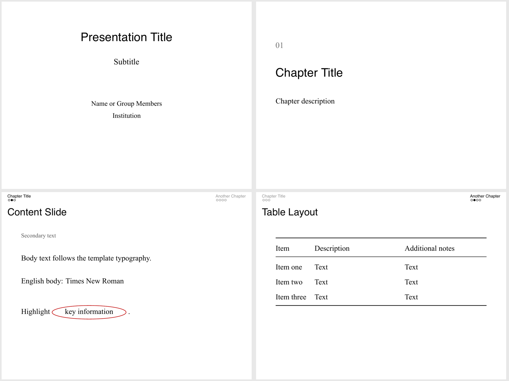

# Herbert Beamer Template

A minimal 4:3 LaTeX Beamer template for academic presentations. It uses a white background, black text, chapter navigation with small circles, and thin red annotations.

The template supports both Chinese and English. The source contains an empty cover, a chapter divider, and an empty content slide. Preview slides use generic placeholder text.

## Files

| File | Purpose |
| --- | --- |
| `template.tex` | Self-contained blank template |
| `PROMPT.txt` | Reusable presentation prompt in English |
| `preview/layout.pdf` | Eight-page layout preview |
| `preview/layout.png` | Overview of the cover, chapter, body, and table layouts |

## Quick start

1. Upload `template.tex` to Overleaf or open it in a local LaTeX editor.
2. Select **XeLaTeX**. Tectonic is also supported.
3. Fill in the empty arguments after `\begin{document}`.
4. Add chapters and slides as needed. Compile twice with XeLaTeX to update navigation.

For an assistant-assisted workflow, copy `PROMPT.txt`, fill in its task fields, and provide it together with `template.tex` and the presentation materials.

## Default style

| Element | Setting |
| --- | --- |
| Aspect ratio | 4:3 |
| Background and text | White background, black text |
| Chinese body | Songti SC, with Noto Serif CJK SC and Fandol fallbacks |
| Chinese headings | Hiragino Sans GB, with Noto Sans CJK SC and Fandol fallbacks |
| English body | Times New Roman, with TeX Gyre Termes as a fallback |
| English headings | TeX Gyre Heros, with Helvetica as a fallback |
| Emphasis | Thin red ellipses, 0.7 pt, color `C00000` |
| Content navigation | Chapter names and small circles at the top |
| Cover and chapter dividers | No navigation |
| Footer | No page numbers or navigation icons |

Font fallbacks allow compilation on systems without the Mac fonts. Their glyph shapes and spacing may differ slightly. The default font sizes, margins, and title positions follow the original presentation style.

## Common commands

### Cover and chapters

```latex
\deckcover{Title}{Subtitle}{Name or group members}{Institution}
\chapterpage{01}{Chapter title}
\chapterpage[Optional description]{02}{Another chapter}
```

Leave any unused field empty, for example `\deckcover{Title}{}{}{}`. Each chapter command also registers its title in the navigation.

### Content and emphasis

```latex
\begin{frame}[t]{Slide title}
  \subtitleline{Optional secondary text}
  Body text with \highlightvalue{a key point}.
\end{frame}
```

### Two columns

```latex
\begin{frame}[t]{Slide title}
  \begin{columns}[T,onlytextwidth]
    \begin{column}{.48\textwidth}
      Left column
    \end{column}
    \begin{column}{.48\textwidth}
      Right column
    \end{column}
  \end{columns}
\end{frame}
```

### Images and annotations

Place your images in an `assets` folder next to `template.tex`.

```latex
\slideimage{image.png}
\slideimage[.85\textwidth]{image.png}

\annotatedimage{screenshot.png}{.8\textwidth}{
  \evidenceellipse{0.5}{0.5}{0.15}{0.06}
}
```

The ellipse arguments are center x, center y, horizontal radius, and vertical radius. Coordinates are relative to the image: the bottom-left corner is `(0,0)` and the top-right corner is `(1,1)`. Adjust the image width to fit the remaining slide area.

### Video prompts and contact slides

```latex
\videopage{Slide title}{Please watch the video}
\contactpage{Questions}{Discussion topics}{qr-code.png}
```

The video command creates a prompt slide. Arrange video playback for the presentation environment separately. Leave the third contact-page argument empty when no image is needed.

### Tables

The template loads `booktabs` and `tabularx`. Use three-line tables and the `Y` column type for wrapped text. Keep the row and column count appropriate for the available space.

## Presentation workflow

Use clear chapter names and give more space to the main points. Keep longer explanations in separate speaker notes. Prefer real materials and screenshots, and use thin red circles to direct attention to the relevant evidence.

Slide count, videos, contact information, group members, and visible source pages depend on the specific presentation. Keep source materials available for verification.


